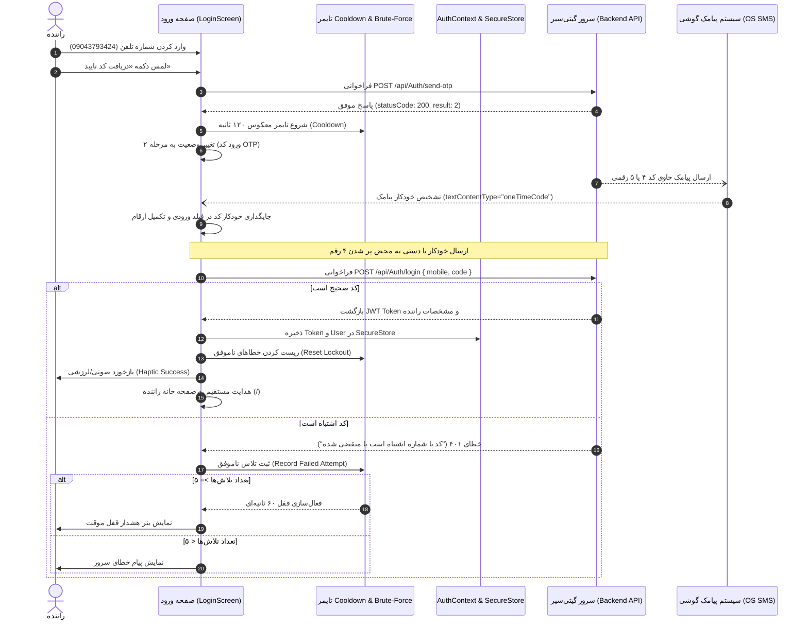

# مستندات سرویس احراز هویت رانندگان گیتی‌سیر (Driver Authentication Service)

این سند معماری، نحوه ذخیره‌سازی توکن، رفتار اندپوینت‌ها، مکانیزم‌های ضد Brute-Force و نحوه جایگذاری خودکار کد پیامک (SMS OTP Autofill) در اپلیکیشن رانندگان گیتی‌سیر را تشریح می‌کند.

---

## ۱. نمای کلی معماری (Stateless Architecture)

اپلیکیشن رانندگان گیتی‌سیر به صورت **Stateless** پیاده‌سازی شده است؛ به این معنی که سرور وضعیت کلاینت را در حافظه سشن خود نگه نمی‌دارد، بلکه کلاینت پس از اعتبارسنجی یک شناسه دسترسی JWT (`token`) به همراه تاریخ انقضا و اطلاعات کاربر دریافت می‌کند.

برای پایداری نشست در کلاینت بدون افشای اطلاعات حساس، توکن و اطلاعات راننده با استفاده از ماژول بومی سخت‌افزاری `expo-secure-store` ذخیره می‌شوند:
- **در سیستم‌عامل iOS:** ذخیره مستقیم در **iOS Keychain** با سطح دسترسی `WHEN_UNLOCKED_THIS_DEVICE_ONLY`.
- **در سیستم‌عامل Android:** رمزنگاری و ذخیره در **Android KeyStore** از طریق `EncryptedSharedPreferences`.
- **در بستر وب (Web Fallback):** ذخیره در `window.localStorage` با فال‌بک به ساختار داده درون‌حافظه‌ای (`memoryStore`).

---

## ۲. دیاگرام توالی احراز هویت (Authentication Sequence Diagram)



---

## ۳. مشخصات اندپوینت‌ها (API Specifications)

آدرس پایه سرور: `https://backend.vaezprojects.ir`

### ۳.۱. ارسال کد تایید یکبارمصرف (Send OTP)
- **مسیر:** `/api/Auth/send-otp`
- **متد:** `POST`
- **هدرها:** `Content-Type: application/json`
- **بدنه درخواست (Request Body):**
```json
{
  "mobile": "09043793424"
}
```
- **پاسخ موفق (HTTP 200):**
```json
{
  "statusCode": 200,
  "success": true,
  "message": "کد با موفقیت ارسال شد.",
  "result": 2
}
```
- **پاسخ خطای سرور یا اعتبارسنجی:**
```json
{
  "statusCode": 500,
  "success": false,
  "message": "خطایی پیش آمده.",
  "result": null
}
```

---

### ۳.۲. ورود راننده با کد تایید (Verify OTP & Login)
- **مسیر:** `/api/Auth/login`
- **متد:** `POST`
- **هدرها:** `Content-Type: application/json`
- **بدنه درخواست (Request Body):**
```json
{
  "mobile": "09043793424",
  "code": "1234"
}
```
- **پاسخ موفق (HTTP 200):**
```json
{
  "statusCode": 200,
  "success": true,
  "message": null,
  "result": {
    "token": "eyJhbGciOiJIUzI1NiIsInR5cCI6IkpXVCJ9...",
    "user": {
      "id": 4067,
      "name": "تست پشتیبانی",
      "family": "تست",
      "phoneNumber": "09043793424",
      "createDate": "2026-09-30T01:09:38.1603659",
      "nationalCode": "0999999999",
      "isActive": true,
      "otpExpire": null,
      "company": null,
      "driverId": null,
      "userRoles": [
        {
          "userId": 4067,
          "roleId": 3,
          "role": {
            "id": 3,
            "name": "Passenger",
            "roleClaims": []
          }
        }
      ]
    },
    "isDriver": false,
    "isAdmin": false,
    "isLeadDriver": false,
    "tokenExpireDate": "2026-10-26T12:07:37.4256305+03:30"
  }
}
```
- **پاسخ خطا در صورت کد اشتباه یا منقضی شده:**
```json
{
  "statusCode": 401,
  "success": false,
  "message": "کد یا شماره اشتباه است یا منقضی شده",
  "result": null
}
```

---

## ۴. جایگذاری خودکار پیامک (SMS OTP Autofill)

برای اینکه راننده هنگام رانندگی یا در شرایط پرمشغله نیازی به باز کردن صندوق پیامک و کپی-پیست دستی نداشته باشد، کامپوننت `login.tsx` با ویژگی‌های استاندارد پلتفرم‌های موبایل یکپارچه شده است:

```tsx
<TextInput
  ref={otpInputRef}
  value={otpInput}
  onChangeText={handleOtpChange}
  keyboardType="number-pad"
  textContentType="oneTimeCode" // شناسایی خودکار پیامک در iOS
  autoComplete="sms-otp"        // پر کردن خودکار در Android
  inputMode="numeric"
  maxLength={6}
/>
```

### نحوه کار:
1. **در iOS:** به محض دریافت پیامک از سرور، سیستم‌عامل کد پیامک را استخراج کرده و بالای صفحه‌کلید نمایش می‌دهد. با یک لمس یا به صورت خودکار، مقدار وارد فیلد می‌شود.
2. **در Android:** با ویژگی `autoComplete="sms-otp"`، سرویس Google Play Services و صفحه‌کلید Gboard کد را پیشنهاد داده و به داخل فیلد منتقل می‌کنند.
3. **تکمیل و ارسال هوشمند:** به محض اینکه طول کاراکترهای ورودی به ۴ رقم یا بیشتر برسد، رویداد `handleVerifyOtp` با یک تاخیر کوتاه ۱۵۰ میلی‌ثانیه‌ای (برای ثبات انیمیشن UI) به طور خودکار اجرا می‌شود.

---

## ۵. مکانیزم‌های مقابله با Brute Force و ارسال رگباری (Rate Limiting)

برای محافظت از سامانه در برابر حملات جستجوی فراگیر و ارسال اسپم پیامکی:

1. **تایمر معکوس Cooldown (۱۲۰ ثانیه‌ای):**
   - پس از ارسال درخواست کد تایید، دکمه «ارسال مجدد» بلافاصله غیرفعال می‌شود.
   - زمان باقیمانده به صورت ارقام فارسی زنده (مانند `۰۱:۴۵`) نمایش داده می‌شود.
   - هدف زمانی بر مبنای `timestamp` دقیق سنجیده می‌شود تا کاربر با بستن و باز کردن سریع صفحه نتواند تایمر را دور بزند.

2. **قفل حساب پس از ۵ تلاش اشتباه متوالی (Lockout Protection):**
   - سیستم تعداد دفعات وارد کردن کد نادرست را برای هر شماره تلفن ثبت می‌کند (`recordFailedVerification`).
   - در صورت ثبت **۵ خطای متوالی**، شماره تلفن به مدت **۶۰ ثانیه قفل کامل** می‌شود.
   - در زمان قفل بودن، دکمه ورود غیرفعال شده و بنر هشدار قرمز با نمایش ثانیه‌شمار قفل به کاربر نشان داده می‌شود.
   - ورود موفقیت‌آمیز، شمارنده خطاهای شماره مربوطه را پاکسازی می‌کند (`resetVerificationAttempts`).

3. **جلوگیری از ارسال درخواست‌های همزمان (Debounce & In-Flight Lock):**
   - متغیر پرچم `isSubmitting` در لحظه فشرده شدن دکمه فعال شده و دکمه را غیرفعال می‌کند تا از ایجاد درخواست‌های تکراری در اثر چندبار تپ سریع جلوگیری شود.

---

## ۶. ساختار ذخیره‌سازی نشست (Session Storage Keys)

کلیدهای استفاده شده در `src/services/storage/secure-storage.ts`:

| کلید در Storage | نوع داده | توضیحات |
| :--- | :--- | :--- |
| `gitiseir_auth_token` | `string` | توکن JWT امضاشده برگشتی از سرور جهت ارسال در هدر `Authorization: Bearer` |
| `gitiseir_auth_user` | `JSON string` | شیء کاربر شامل `id`، `name`، `family`، `phoneNumber`، `nationalCode` و نقش‌ها |
| `gitiseir_token_expire` | `ISO string` | تاریخ و زمان انقضای توکن جهت اعتبارسنجی خودکار در هنگام باز شدن اپلیکیشن |

---

## ۷. هماهنگی با طراحی و تم‌ها

صفحه ورود و پروفایل به طور کامل از اصول طراحی لوکس گیتی‌سیر پیروی می‌کنند:
- **تم تیره (Dark Luxury Gold):** پس‌زمینه `#0B0F19`، کارت‌های تیره `#111827`، تأکید طلایی `#D4AF37` و خطوط ملایم.
- **تم روشن (Light Milky Gold):** پس‌زمینه شیری `#FAF7F2`، کارت‌های سفید `#FFFFFF`، رنگ متن سرمه‌ای با کنتراست بالا `#0F172A` و حاشیه‌های طلایی ملایم.
- **تایپوگرافی و ارقام:** فونت اختصاصی `Vazirmatn` و تبدیل تمام ارقام ورودی، زمان‌سنج‌ها و اطلاعات راننده به ارقام فارسی از طریق `toPersianDigits`.
- **بازخورد لرزشی (Haptics):** استفاده از `expo-haptics` برای بازخورد فیزیکی در لحظه ارسال موفق، خطا و تکمیل کد.
