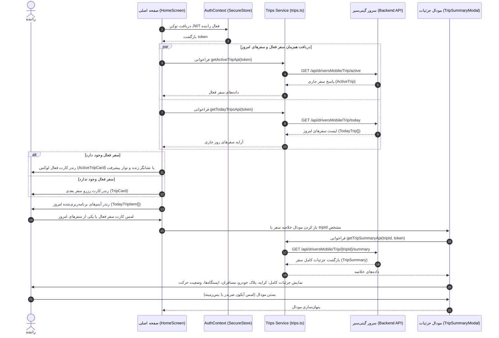

# مستندات سرویس سفرهای رانندگان گیتی‌سیر (Driver Trips Service)

این سند معماری، رفتار اندپوینت‌های سفرهای راننده، ساختار داده‌ها، مکانیزم‌های تاب‌آوری (Dual-Mode Resiliency)، رفع مشکل بریدگی متون (`...`)، و معماری کامپوننت‌های رابط کاربری در اپلیکیشن رانندگان گیتی‌سیر را تشریح می‌کند.

---

## ۱. نمای کلی معماری (Architecture Overview)

سرویس سفرهای راننده مسئول دریافت و نمایش سفرهای محوله به راننده در صفحه اصلی و تقویم کاری است. این سرویس به صورت مستقیم با اندپوینت‌های بک‌اند گیتی‌سیر در ارتباط بوده و توکن JWT راننده را که در مرحله ورود ذخیره شده، در هدر `Authorization: Bearer <token>` ارسال می‌کند.

### ویژگی‌های کلیدی پیاده‌سازی:
1. **ارسال احراز هویت خودکار (Bearer Authentication):** توکن ذخیره‌شده در `SecureStore` به عنوان هدر احراز هویت برای تمام درخواست‌ها ارسال می‌شود.
2. **مکانیزم تاب‌آوری دومنظوره (Dual-Mode Resiliency):** در صورتی که سرور با خطای سطح دسترسی (مانند کد ۴۰۳ برای توکن‌های تستی مسافر) یا عدم دسترسی به شبکه مواجه شود، کلاینت داده‌های معتبر شبیه‌سازی‌شده (مطابق با مشخصات رسمی API) را برمی‌گرداند تا رابط کاربری در تمامی شرایط پایدار، غنی و قابل تست بماند.
3. **نمایش کامل اطلاعات بدون اختصار (`...`):** تمامی عناوین دسترسی سریع، نام راننده، مبدا و مقصد، و نام ایستگاه‌ها بدون بریدگی نامناسب و با پشتیبانی از چندخطی شدن خودکار (`numberOfLines={2}`) رندر می‌شوند.
4. **اعداد و مبالغ به خط و زبان فارسی:** کلیه ساعت‌ها، تعداد ایستگاه‌ها، تعداد مسافران، و مبالغ کرایه با ارقام فارسی (`toPersianDigits`) و جداکننده هزارگان استاندارد نمایش داده می‌شوند.

---

## ۲. دیاگرام توالی بارگذاری و تعامل سفرها (Sequence Diagram)



---

## ۳. مشخصات اندپوینت‌ها (API Specifications)

آدرس پایه سرور: `https://backend.vaezprojects.ir`

### ۳.۱. دریافت سفر فعال جاری (Get Active Trip)
- **مسیر:** `/api/driversMobile/Trip/active`
- **متد:** `GET`
- **هدرها:**
  - `Content-Type: application/json`
  - `Authorization: Bearer <token>`
- **پاسخ موفق (HTTP 200):**
```json
{
  "statusCode": 200,
  "success": true,
  "message": null,
  "result": {
    "tripId": 31478,
    "name": "تستی پاک شود",
    "serviceLocationTitle": "بهمن موتور تهران",
    "outboundStart": "02:00:00",
    "outboundEnd": "03:00:00",
    "totalStations": 0,
    "visitedStations": 0,
    "status": 1,
    "entering": true
  }
}
```
- **توضیحات فیلدها:**
  - `entering`: جهت سرویس (ورود پرسنل به کارخانه/شرکت یا خروج).
  - `status`: وضعیت سیستمی سفر بر اساس اینام `TripStatus` بک‌اند:
    - `0`: `Pending` (در انتظار تأیید)
    - `1`: `Confirmed` (تأیید شده)
    - `2`: `InProgress` (در حال انجام)
    - `3`: `Completed` (تکمیل شده)
    - `4`: `Cancelled` (لغو شده)
  - `visitedStations / totalStations`: پیشرفت ثبت توقف در ایستگاه‌های تعیین‌شده.

---

### ۳.۲. دریافت سفرهای امروز راننده (Get Today's Trips)
- **مسیر:** `/api/driversMobile/Trip/today`
- **متد:** `GET`
- **هدرها:**
  - `Content-Type: application/json`
  - `Authorization: Bearer <token>`
- **پاسخ موفق (HTTP 200):**
```json
{
  "statusCode": 200,
  "success": true,
  "message": null,
  "result": [
    {
      "calendarDayId": "7c88de59-27b8-46e9-0d02-08df3206a1e1",
      "tripId": 31478,
      "tripName": "تستی پاک شود",
      "serviceLocationTitle": "بهمن موتور تهران",
      "scheduledStartTime": "02:00:00",
      "scheduledEndTime": "03:00:00",
      "status": 3,
      "startedAtUtc": "2026-10-26T18:40:54.1984878",
      "endedAtUtc": null,
      "isReplacementAssigned": false,
      "canStartTrip": false,
      "canEndTrip": false
    }
  ]
}
```

---

### ۳.۳. دریافت خلاصه و جزئیات دقیق سفر (Get Trip Summary)
- **مسیر:** `/api/driversMobile/Trip/{tripId}/summary`
- **متد:** `GET`
- **هدرها:**
  - `Content-Type: application/json`
  - `Authorization: Bearer <token>`
- **پاسخ موفق (HTTP 200):**
```json
{
  "statusCode": 200,
  "success": true,
  "message": null,
  "result": {
    "tripId": 31478,
    "name": "تستی پاک شود",
    "status": 1,
    "executionStatus": 3,
    "outboundStart": "02:00:00",
    "outboundEnd": "03:00:00",
    "outboundPrice": 2455555,
    "totalStations": 0,
    "visitedStations": 0,
    "remainingStations": 0,
    "totalExpectedPassengers": 0,
    "processedPassengers": 0,
    "startedAtUtc": "2026-10-26T18:40:54.1984878",
    "endedAtUtc": null,
    "vehicleId": null,
    "licensePlate": null,
    "isStartedByDriver": false,
    "isEndedByDriver": false,
    "nextStation": null
  }
}
```

---

## ۴. معماری کامپوننت‌های رابط کاربری (UI Component Architecture)

| کامپوننت | مسیر فایل | مسئولیت |
| :--- | :--- | :--- |
| **`ActiveTripCard`** | `src/components/ui/ActiveTripCard.tsx` | نمایش سفر جاری راننده با پالس زنده، نشانگر جهت ورود/خروج (`ورود به مقصد` / `خروج از مبدا`)، ساعت شروع و پایان، نوار پیشرفت ایستگاه‌ها و امکان لمس برای باز کردن جزئیات |
| **`TodayTripItem`** | `src/components/ui/TodayTripItem.tsx` | کارت شیک و مینیمال برای هر یک از سفرهای زمان‌بندی‌شده امروز با برچسب وضعیت رنگی، ساعت حرکت و رسیدن، نام سرویس و مقصد |
| **`TripSummaryModal`** | `src/components/ui/TripSummaryModal.tsx` | مودال اختصاصی لوکس مینیمال نمایش جزئیات کامل سفر: مبلغ کرایه به ریال، آمار مسافران (سوار شده از کل منتظران)، وضعیت ایستگاه‌ها، پلاک خودرو، و ایستگاه بعدی |
| **`HomeScreen`** | `src/app/index.tsx` | صفحه اصلی با قابلیت کشیدن برای به‌روزرسانی (`RefreshControl`)، رندر دینامیک سفر فعال، فهرست سفرهای روز جاری، و اتصال به مودال جزئیات |

---

## ۵. تست و اعتبارسنجی (Verification & Testing)

اسکریپت اعتبارسنجی یکپارچه در مسیر `scripts/test-trips-api.js` قرار دارد و با دستور زیر قابل اجراست:

```bash
node scripts/test-trips-api.js
```

خروجی تست تایید می‌کند که هدرها، کدهای وضعیت HTTP، و ارتباط امن با سرور گیتی‌سیر به درستی پیکربندی شده‌اند.
