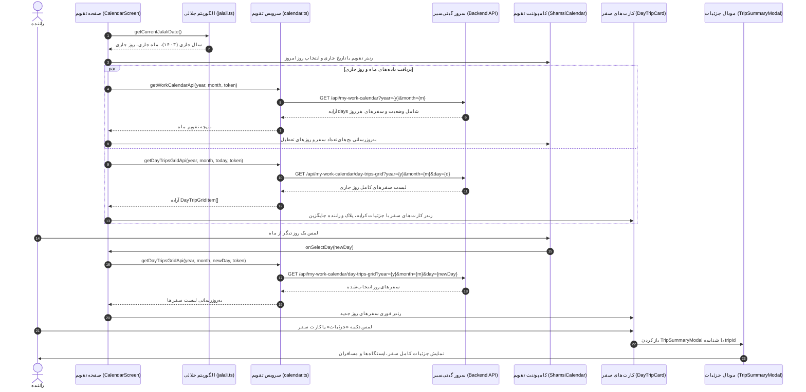

# مستندات سرویس تقویم کاری رانندگان گیتی‌سیر (Driver Work Calendar Service)

این سند معماری، مشخصات اندپوینت‌ها، نحوه محاسبه دقیق آفست تقویم شمسی، رفتار لود اولیه بر روی روز و ماه جاری، و معماری نمایش پرتعداد سفرها (High-Density Day Trips Grid) در اپلیکیشن رانندگان گیتی‌سیر را تشریح می‌کند.

---

## ۱. نمای کلی معماری (Architecture Overview)

سرویس تقویم کاری رانندگان شامل دو اندپوینت مکمل است:
1. **واکشی وضعیت کل ماه (`/api/my-work-calendar`):** برای دریافت وضعیت تمامی روزهای ماه (روزهای تعطیل، تعداد سفرها، وضعیت فعال بودن روز کاری) و نمایش بج‌های تعداد سفر و نشانگرهای تعطیلی در تقویم شمسی.
2. **واکشی شبکه سفرهای یک روز خاص (`/api/my-work-calendar/day-trips-grid`):** به محض لمس هر روز از تقویم، فهرست کامل سفرهای آن روز به همراه ساعات حرکت، مبلغ کرایه، پلاک و مدل خودرو، وضعیت سفر، و مشخصات راننده جایگزین (در صورت وجود) واکشی و در کارت‌های لوکس رندر می‌شود.



---

## ۲. مشخصات اندپوینت‌ها (API Specifications)

آدرس پایه سرور: `https://backend.vaezprojects.ir`

### ۲.۱. دریافت تقویم کاری ماهانه (Get Monthly Work Calendar)
- **مسیر:** `/api/my-work-calendar`
- **متد:** `GET`
- **پارامترهای Query:**
  - `year` (عدد صحیح، اجباری): سال شمسی (مثال: `1403` یا `1405`)
  - `month` (عدد صحیح، اجباری): ماه شمسی (مثال: `7` برای مهر یا `8` برای آبان)
  - `tripId` (عدد صحیح، اختیاری): شناسه سفر خاص در صورت فیلتر
- **هدرها:**
  - `Content-Type: application/json`
  - `Authorization: Bearer <token>`
- **نمونه پاسخ موفق (HTTP 200):**
```json
{
  "statusCode": 200,
  "success": true,
  "message": null,
  "result": {
    "days": [
      {
        "year": 1405,
        "month": 7,
        "day": 1,
        "dayOfWheek": "چهارشنبه",
        "isHoliday": false,
        "isToday": false,
        "isWorkingDay": true,
        "isSelectableForLeadDriver": false,
        "isSelectableInCalendarSet": false,
        "isSelectableInReadOnly": false,
        "trips": []
      },
      {
        "year": 1405,
        "month": 7,
        "day": 4,
        "dayOfWheek": "شنبه",
        "isHoliday": false,
        "isToday": false,
        "isWorkingDay": true,
        "isSelectableForLeadDriver": false,
        "isSelectableInCalendarSet": false,
        "isSelectableInReadOnly": true,
        "trips": [
          {
            "tripWorkCalendarId": "d3018ae7-34f1-40ab-7487-08df1a1c035a",
            "tripId": 20020,
            "tripName": "کروز قدیم تهران",
            "outbound": {
              "start": "05:00:00",
              "end": "06:00:00",
              "maxSurveyTime": "07:00:00",
              "price": 1000000
            },
            "inbound": null,
            "driverFullName": "حسین گلشاهی",
            "driverId": 1044,
            "hasTemporaryDriver": false,
            "canSetTemporaryDriver": false
          }
        ]
      }
    ]
  }
}
```

---

### ۲.۲. دریافت شبکه سفرهای روز خاص (Get Day Trips Grid)
- **مسیر:** `/api/my-work-calendar/day-trips-grid`
- **متد:** `GET`
- **پارامترهای Query:**
  - `year` (عدد صحیح، اجباری): سال شمسی
  - `month` (عدد صحیح، اجباری): ماه شمسی
  - `day` (عدد صحیح، اجباری): روز انتخابی (مثال: `15`)
- **هدرها:**
  - `Content-Type: application/json`
  - `Authorization: Bearer <token>`
- **نمونه پاسخ موفق (HTTP 200):**
```json
{
  "statusCode": 200,
  "success": true,
  "message": null,
  "result": [
    {
      "tripWorkCalendarId": "7d664862-0cbd-421a-7497-08df1a1c035a",
      "tripId": 21454,
      "tripName": "جهاد",
      "status": 0,
      "statusDisplay": "Pending",
      "passengerId": null,
      "passengerFullName": null,
      "driverId": 1044,
      "driverFullName": "حسین گلشاهی",
      "driverTel": "02156178898",
      "licensePlate": "64ی274 ایران 78",
      "carBodyColor": "سفید",
      "carModelYear": 1386,
      "carType": "207",
      "outbound": {
        "start": "19:00:00",
        "end": "20:09:09",
        "maxSurveyTime": "20:24:09",
        "price": 1000000
      },
      "inbound": null,
      "temporaryDriverId": null,
      "temporaryDriver": null,
      "hasTemporaryDriver": false,
      "canSetTemporaryDriver": false
    }
  ]
}
```

---

## ۳. ویژگی‌های فنی و طراحی کاربری

1. **لود بلافاصله بر روی ماه و روز جاری:**
   به محض ورود کاربر به صفحه تقویم، توابع زمان جلالی مستقیماً سال، ماه، و روز تقویم را به تاریخ روز جاری میزان می‌کنند؛ روز جاری با حلقه حاشیه طلایی متمایز می‌شود و سفرهای همان روز واکشی می‌گردند.
2. **محاسبه دقیق آفست شروع ماه (`getJalaliMonthStartWeekday`):**
   با استفاده از الگوریتم معکوس `jalaliToGregorian`، روز اول هر ماه شمسی (از جمله سال‌های کبیسه) دقیقاً در ستون روز هفته متناظر خود (شنبه=۰ تا جمعه=۶) قرار می‌گیرد.
3. **مدیریت حجم بالای سفرها در یک روز (High Trip Density):**
   حتی اگر در یک روز تعداد زیادی سفر تخصیص داده شده باشد (مانند ۶ سفر ثبت‌شده در داده‌های تست)، کامپوننت `DayTripCard` اطلاعات را به شکل فشرده، تفکیک‌شده و منظم نمایش داده و با انیمیشن روان اسکرول می‌شود.
4. **پشتیبانی از راننده جایگزین (`TemporaryDriver`):**
   در صورت تخصیص راننده جایگزین (`hasTemporaryDriver: true`)، یک کادر طلایی-کهربایی با مشخصات کامل راننده جایگزین، شماره تماس و علت جایگزینی به کارت اضافه می‌شود.
5. **اتصال به مودال جزئیات:**
   لمس هر کارت سفر بلافاصله `TripSummaryModal` اختصاصی را برای بررسی ایستگاه‌ها و مسافران باز می‌کند.
