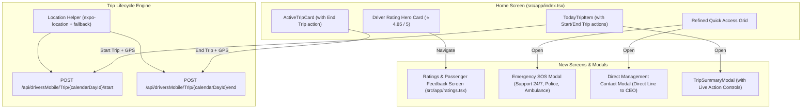

# Driver Trip Lifecycle, Ratings & Emergency Services Implementation Plan

> **For agentic workers:** REQUIRED SUB-SKILL: Use superpowers:subagent-driven-development (recommended) or superpowers:executing-plans to implement this plan task-by-task. Steps use checkbox (`- [ ]`) syntax for tracking.

This plan integrates the **Trip Start & End API with device geolocation**, a **Luxury SOS / Emergency Contact system (MOB-05)**, a **Full Driver Ratings & Passenger Survey screen with top positive/negative tags**, and a **Direct Management Communication channel** into the Gitiseir Driver mobile application.

---

## Architectural Analysis & Current State Assessment

### Current Project Readiness
1. **Trip Lifecycle:** The app currently fetches active trips (`/api/driversMobile/Trip/active`) and today's schedule (`/api/driversMobile/Trip/today`). `TodayTrip` already includes `calendarDayId: string` (UUID), `canStartTrip: boolean`, and `canEndTrip: boolean`. Adding start/end POST endpoints with device GPS coordinates will complete the real-time trip lifecycle.
2. **Device Location:** The project runs Expo SDK 58. `expo-location` should be added to `package.json` (`npx expo install expo-location`). A location service utility (`src/services/location/gps.ts`) will encapsulate permission requests, timeout handling, and graceful fallback coordinates (Tehran center) to ensure the driver is never blocked by GPS glitches or simulator environments.
3. **Quick Access vs. Star Rating Widget:** Currently, `QuickAccessGrid` contains 8 equal square boxes. As requested, we will decouple the top of the Home Screen:
   - A prominent, elegant **Driver Rating Hero Widget** (showing the ⭐ score, review count, and quick positive highlights) that navigates to the dedicated `/ratings` screen.
   - A reorganized **Quick Access Grid** integrating **«ارتباط با مدیریت»** and **«اورژانس SOS»** alongside schedule and documents.
4. **Driver Ratings Screen (`/ratings`):** A dedicated screen displaying large gold stars, score breakdown, top 2-3 positive traits with vote counts, top 2-3 improvement areas with vote counts, and weekly trip performance.

---

## Architecture & Data Flow

---

## File Structure & Responsibilities

| File | Responsibility |
| :--- | :--- |
| `src/services/location/gps.ts` | Handles permission requests and gets current device coordinates with fallback coordinates for web/simulator. |
| `src/services/api/trips.ts` | Adds `startTripApi(calendarDayId, coords, token)` and `endTripApi(calendarDayId, coords, token)`. |
| `src/services/api/ratings.ts` | Provides driver ratings data (average score, star distribution, top positive/negative tags, weekly trip metrics). |
| `src/components/ui/DriverRatingBanner.tsx` | Hero star rating card on Home Screen displaying overall score, gold stars, review count, and quick tag pills. |
| `src/components/ui/SosEmergencyModal.tsx` | Luxury modal for SOS emergency calls: direct 24/7 support line, police 110, ambulance 115, and location broadcasting. |
| `src/components/ui/ManagementContactModal.tsx` | Modal allowing drivers to submit suggestions, complaints, or private reports directly to the management team. |
| `src/app/ratings.tsx` | Full-page screen dedicated to passenger survey feedback: score breakdown, top positive attributes, areas for improvement, and trip counts. |
| `src/components/ui/ActiveTripCard.tsx` | Adds live «پایان سفر» button with confirmation dialog and GPS capture. |
| `src/components/ui/TodayTripItem.tsx` | Adds contextual «شروع سفر» (when `canStartTrip: true`) and «پایان سفر» (when `canEndTrip: true`). |
| `src/components/ui/QuickAccessGrid.tsx` | Updated grid items to include «ارتباط با مدیریت» and «تماس اضطراری SOS». |
| `src/app/index.tsx` | Embeds `DriverRatingBanner`, connects Start/End handlers with refresh, and hooks up new modals. |

---

## Implementation Tasks

### Task 1: Location Service & Trip Lifecycle APIs (Start / End)
- [ ] Install `expo-location` via `npx expo install expo-location`.
- [ ] Create `src/services/location/gps.ts`:
  - `getCurrentCoordinates()`: requests permissions, gets `{ latitude, longitude }`, and falls back to default Tehran coordinates if permission is denied or running in emulator.
- [ ] Update `src/services/api/trips.ts`:
  - Implement `startTripApi(calendarDayId: string, coords: { latitude: number; longitude: number }, token?: string | null)`: calls `POST /api/driversMobile/Trip/{calendarDayId}/start`.
  - Implement `endTripApi(calendarDayId: string, coords: { latitude: number; longitude: number }, token?: string | null)`: calls `POST /api/driversMobile/Trip/{calendarDayId}/end`.
  - Include dual-mode resiliency fallback with simulated status updates.
- [ ] Create test script `scripts/test-lifecycle-api.js` to verify endpoint payloads.
- [ ] Verification: `npx tsc --noEmit` and `npm run lint`.

### Task 2: Trip Start & End Actions in UI (ActiveCard, TodayItem & SummaryModal)
- [ ] Update `src/components/ui/ActiveTripCard.tsx`:
  - Add an «پایان سفر» button (red/gold theme) with a confirmation alert and loading spinner.
  - Call GPS helper -> invoke `endTripApi` -> trigger refresh callback.
- [ ] Update `src/components/ui/TodayTripItem.tsx`:
  - When `trip.canStartTrip === true`, render an attractive «شروع سفر» button (green/gold accent).
  - When `trip.canEndTrip === true`, render an «پایان سفر» button.
  - Provide haptic feedback on press.
- [ ] Update `src/components/ui/TripSummaryModal.tsx`:
  - Display contextual Start/End trip action buttons in the modal footer when eligible.
- [ ] Verification: `npx tsc --noEmit` and `npm run lint`.

### Task 3: MOB-05 Emergency SOS Modal (`SosEmergencyModal`)
- [ ] Create `src/components/ui/SosEmergencyModal.tsx`:
  - High-visibility red & gold luxury styling.
  - Option 1: «تماس فوری با پشتیبانی ۲۴ ساعته گیتی‌سیر» (direct call via `Linking.openURL('tel:...')`).
  - Option 2: «پلیس راهور / ۱۱۰».
  - Option 3: «اورژانس / ۱۱۵».
  - Option 4: «امداد خودروی شبانه‌روزی».
  - Display current GPS coordinates and driver vehicle plate on screen for quick reference during calls.
- [ ] Verification: `npx tsc --noEmit` and `npm run lint`.

### Task 4: Direct Management Contact Modal (`ManagementContactModal`)
- [ ] Create `src/components/ui/ManagementContactModal.tsx`:
  - Direct channel to executive management.
  - Form fields:
    - Topic selection: پیشنهاد بهبود (Suggestion), گزارش تخلف یا مشکل (Report issue), پیام خصوصی به مدیریت (Private message).
    - Message body text area (`TextInput` with RTL and character counter).
    - Importance level badge (معمولی / فوری).
  - Submit button with success toast and haptic feedback.
- [ ] Verification: `npx tsc --noEmit` and `npm run lint`.

### Task 5: Driver Ratings Service & Full Screen (`/ratings`)
- [ ] Create `src/services/api/ratings.ts`:
  - Data models: `DriverRatingStats`, `SurveyTagCount`, `RatingBreakdown`.
  - Sample realistic dataset:
    - Average score: `۴.۸۵` from `۳۴۲` reviews.
    - Top positive tags:
      1. «بوی مطبوع و هوای تمیز خودرو» (۴۸ رای)
      2. «رانندگی ایمن و رعایت سرعت مجاز» (۳۹ رای)
      3. «آراستگی ظاهری و خوش‌رویی راننده» (۲۷ رای)
      4. «تمیزی صندلی‌ها و کابین» (۲۱ رای)
    - Top improvement tags:
      1. «تاخیر در حرکت از مبدا» (۴ رای)
      2. «کندی سیستم سرمایش/گرمایش» (۲ رای)
      3. «صدای بالای رادیو یا موسیقی» (۱ رای)
    - Weekly trip count: ۲۴ سفر این هفته، ۴ سفر امروز.
- [ ] Create `src/app/ratings.tsx`:
  - Header with Back button and AppHeader.
  - Hero Rating Display (big gold score, star row, breakdown bars).
  - Positive Highlights Section: 3 top positive cards with counts, percentage, and cheerful badge.
  - Areas for Improvement Section: 3 top improvement cards with gentle constructive tips.
  - Weekly & Daily Trip Summary banner.
  - Click on any tag opens an explanatory toast/modal with passenger insights.
- [ ] Verification: `npx tsc --noEmit` and `npm run lint`.

### Task 6: Home Screen Reorganization (Rating Banner & Refined QuickAccess)
- [ ] Create `src/components/ui/DriverRatingBanner.tsx`:
  - Compact hero widget placed above Quick Access Grid on Home Screen.
  - Displays: ⭐ `۴.۸۵` امتیاز کیفی شما • `۳۴۲` نظر ثبت‌شده.
  - Shows mini pills of the top 2 positive traits (e.g. «خوش‌بو» • «رانندگی ایمن»).
  - "مشاهده نظرات مسافران >" navigating to `/ratings`.
- [ ] Update `src/components/ui/QuickAccessGrid.tsx`:
  - Add «ارتباط مستقیم با مدیریت» (Direct line to CEO).
  - Add «تماس اضطراری SOS» (High priority emergency action).
  - Retain «تقویم کاری», «کارت راننده», «پشتیبانی شرکت», «مدارک».
- [ ] Integrate into `src/app/index.tsx`:
  - Render `DriverRatingBanner`.
  - Wire SOS modal and Management modal handlers.
  - Wire Start/End trip handlers with GPS capture and auto-refresh.
- [ ] Verification: `npx tsc --noEmit` and `npm run lint`.

### Task 7: Full Verification, Typecheck, Lint & Documentation
- [ ] Run full project verification: `npx tsc --noEmit` and `npm run lint`.
- [ ] Document all new endpoints and features in `docs/TRIP_LIFECYCLE_AND_RATINGS.md`.
- [ ] Ensure zero warnings and zero TypeScript errors.
